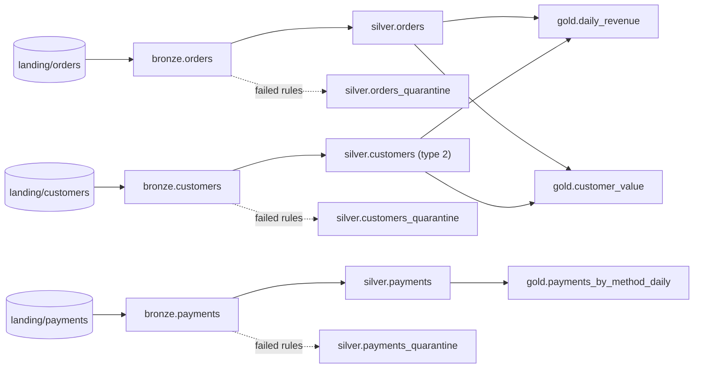

# Databricks medallion lakehouse

[](https://github.com/darshansatpathy/databricks-medallion-lakehouse/actions/workflows/ci.yml)
[](https://github.com/darshansatpathy/databricks-medallion-lakehouse/actions/workflows/codeql.yml)
[](LICENSE)

A medallion lakehouse on Databricks where **each table is a small specification** and everything else is
generated and checked: Lakeflow pipeline SQL, Unity Catalog governance, a Databricks Asset Bundle, and the
documentation. A policy linter fails the build when a table breaks the rules, and a reference executor
builds the whole lakehouse from sample data so the *meaning* of the specification is tested, not only its
text.



## What is in it

- **Nine tables** across three layers for orders, customers and payments, each described in
  [`spec/tables/`](spec/tables), with owner, domain, classification, typed columns, expectations and, for
  gold, the grain.
- **Sixteen policy rules** (`MED000` to `MED015`) over the specification: references, layering,
  the shape of each layer, personal data and masks, expectations, type 2 consumption, a safe and portable
  expression subset, least-privilege grants, naming and classification. See
  [policy rules](docs/generated/policy-rules.md).
- **Generated Lakeflow SQL**: bronze streaming tables over `read_files`; silver as a validated staging
  table, an `AUTO CDC` flow (type 1 or type 2) and a quarantine table; gold as materialized views.
- **Generated Unity Catalog SQL** per environment: catalog, schemas, a landing volume, column-mask
  functions and grants.
- **A Databricks Asset Bundle**: one pipeline, one job (governance first, then the pipeline) and three
  targets.
- **Generated documents**: [data dictionary](docs/generated/data-dictionary.md),
  [lineage](docs/generated/lineage.md), [classification](docs/generated/classification.md),
  [access](docs/generated/access.md), [quality register](docs/generated/quality.md) and a
  [sample run](docs/generated/sample-run.md).
- **A reference executor** that builds every table from the files in [`spec/data/`](spec/data) with Python
  and SQLite, covering late events, deletes, type 2 history, quarantine, masks and gold totals.

## Quick start

```bash
python -m venv .venv && source .venv/bin/activate
pip install -e ".[dev]"

medallion lint                 # check the specification against the policy rules
medallion generate             # write bundle/ and docs/generated/
medallion generate --check     # fail if the committed generated files are out of date
medallion run                  # build the lakehouse from spec/data with the reference executor
medallion rules                # list the policy rules
make check                     # ruff, mypy --strict, pytest with an 85% coverage gate
```

`medallion` has no runtime dependencies and needs Python 3.11 or newer. A clean run:

```text
$ medallion lint
9 tables, 15 rules: 0 findings, 0 waived
$ medallion generate --check
22 generated files are current
$ medallion run
bronze.customers                        9 rows
bronze.orders                          17 rows
bronze.payments                         8 rows
gold.customer_value                     3 rows
gold.daily_revenue                      7 rows
gold.payments_by_method_daily           4 rows
silver.customers                        6 rows, 1 quarantined
silver.orders                           8 rows, 5 quarantined
silver.payments                         4 rows, 1 quarantined
  bronze.customers rescued_data_empty (warn): 1 of 9 rows violate
  ...
```

## A table is a file

```toml
[table]
name = "orders"
layer = "silver"
from = "bronze.orders"
owner = "sales-data"
domain = "sales"
classification = "internal"
comment = "Current state of each order: typed, validated and deduplicated by key. Bad rows go to the quarantine table."

[cdc]
keys = ["order_id"]
sequence_by = "updated_at"
scd = 1
delete_when = "op = 'D'"
drop_columns = ["op"]

[[columns]]
name = "amount"
type = "decimal(18,2)"
expr = "trim(amount)"
comment = "Order total"

[[expectations]]
name = "amount_valid"
rule = "amount IS NOT NULL AND amount >= 0"
action = "drop"            # warn | drop | fail
```

From that, `medallion generate` writes, among other things:

```sql
CONSTRAINT amount_valid EXPECT (amount IS NOT NULL AND amount >= 0) ON VIOLATION DROP ROW
...
try_cast(trim(amount) AS DECIMAL(18,2)) AS amount
...
CREATE FLOW silver_orders_apply_changes AS AUTO CDC INTO ${catalog}.silver.orders
FROM STREAM(${catalog}.silver.orders_validated)
KEYS (order_id)
APPLY AS DELETE WHEN op = 'D'
SEQUENCE BY updated_at
COLUMNS * EXCEPT (op)
STORED AS SCD TYPE 1;
```

and a quarantine table that records, for every dropped row, the names of the rules it failed.

## What the sample run shows

The files in [`spec/data/`](spec/data) include the awkward cases on purpose, and the tests assert the
result for each by hand-derived expectation (see [`tests/test_oracle.py`](tests/test_oracle.py)):

| Case in the data | Result |
|---|---|
| An older update arrives after a newer one | Ignored; the newer one wins |
| An order is deleted by a later event | Removed from silver and from gold |
| A customer's email changes | Two versions; gold uses only the open one |
| An update changes nothing the business tracks | No new version |
| A customer is deleted, then re-created | A closed version, then a new open one |
| An amount of `abc`, `-5`, an empty key, an unparsable date, a corrupt JSON line | Quarantined with the rules they failed |
| `+01:00` and `-05:00` timestamps | Converted to UTC; one order crosses midnight |
| A status the system does not know | Kept, and counted by a `warn` expectation |
| An unexpected field in the source | Held in `_rescued_data`, counted |
| The same customer row read by two kinds of reader | Real email for the privileged group, `***@example.com` for everyone else |

## Design decisions

1. [The specification is the source of truth; SQL is generated](docs/adr/0001-specification-is-the-source-of-truth.md)
2. [Bronze keeps every value as text](docs/adr/0002-bronze-is-raw-text.md)
3. [Three expectation actions, and a quarantine table for drops](docs/adr/0003-expectations-and-quarantine.md)
4. [Change handling with AUTO CDC, not hand-written MERGE](docs/adr/0004-change-handling-with-auto-cdc.md)
5. [Column masks are bound in the table definition, with the pipeline exempt](docs/adr/0005-masks-in-ddl-with-a-runner-exemption.md)
6. [A reference executor on SQLite, with a portable expression subset](docs/adr/0006-reference-executor-on-sqlite.md)
7. [One bundle, three targets, governance before the pipeline](docs/adr/0007-one-bundle-three-targets.md)

More: [architecture](docs/architecture.md), [what the executor assumes](docs/oracle-assumptions.md), and runbooks for
[first deployment](docs/runbooks/first-deployment.md),
[a failed update](docs/runbooks/pipeline-update-failed.md),
[a quarantine spike](docs/runbooks/expectation-drop-spike.md),
[schema drift](docs/runbooks/schema-drift-rescued-data.md),
[backfill and full refresh](docs/runbooks/backfill-and-full-refresh.md) and
[access requests](docs/runbooks/access-request-and-personal-data.md).

## Deploying

The bundle is generated into [`bundle/`](bundle). Before the first deploy, read the
[first deployment runbook](docs/runbooks/first-deployment.md). In short: set the service principal and
warehouse (the bundle ships with a placeholder service principal and requires `warehouse_id`), then from
`bundle/`:

```bash
databricks bundle validate -t dev --var warehouse_id=<id>
databricks bundle deploy   -t dev --var warehouse_id=<id>
databricks bundle run      -t dev retail_lakehouse_daily --var warehouse_id=<id>
```

A manual workflow, [`bundle-validate.yml`](.github/workflows/bundle-validate.yml), validates the bundle
against a workspace using workload identity federation rather than a stored token.

## What has and has not been verified

**Verified by the test suite and CI**

- Every policy rule fires on a broken copy of the specification, and a test asserts no rule is untested.
- The shipped specification passes all rules.
- Generated files match the specification (`medallion generate --check`); the YAML parses and its
  cross-references (variables, file paths, resource keys, task order) resolve.
- The reference executor's results for the sample data match hand-derived expectations, including
  ordering independence (permuted arrival order gives the same result), deletes, type 2 history, quarantine reasons, masks and
  gold totals cross-checked by an independent calculation.
- The gold query the executor runs is the same text, clause for clause, as the Spark SQL the generator emits.
- Code is linted, formatted, type-checked in strict mode and tested on Python 3.11 to 3.13 with an 85%
  coverage gate; the wheel is built and run from a clean environment; CodeQL and `pip-audit` run.

**Not verified, and not claimed**

- **The generated SQL and the bundle have not been run on Databricks.** They follow the current
  documentation for streaming tables, expectations, `AUTO CDC` flows, `read_files`, column masks and
  asset bundles, but a real run may need changes. `databricks bundle validate` is the first thing to run;
  the first-deployment runbook lists the rest.
- **The executor is a model, not Databricks.** Its assumptions about the runtime are listed in
  [oracle-assumptions](docs/oracle-assumptions.md). The riskiest are how type 2 treats an update that
  changes nothing tracked, and how `NULL` is treated by expectations.
- **Decimals are floats in the executor.** Money is compared to the cent; Spark computes exactly.
- **Performance, cost, streaming behaviour and schema evolution are not modelled.**
- **Placeholders**: the service principal ID, the warehouse ID, the group names and the catalog pattern
  are examples. The sample data is invented.
- **Masks do not protect Delta Sharing recipients**; do not share these tables directly.
- Mermaid diagrams are rendered by GitHub; they were not rendered during development.

## Related repositories

- [`ai-platform-reference-architecture`](https://github.com/darshansatpathy/ai-platform-reference-architecture): the platform this lakehouse is the data layer of; its fitness-function approach is applied here to data
- [`lakehouse-iceberg-trino`](https://github.com/darshansatpathy/lakehouse-iceberg-trino): the same medallion idea on open table formats and Trino
- [`azure-ai-landing-zone`](https://github.com/darshansatpathy/azure-ai-landing-zone): private, keyless Azure foundation with policy-as-code

## Contributing and security

See [CONTRIBUTING.md](CONTRIBUTING.md) and [SECURITY.md](SECURITY.md). Do not commit real customer data,
credentials, workspace URLs or service principal IDs.

## Licence

MIT. See [LICENSE](LICENSE).
