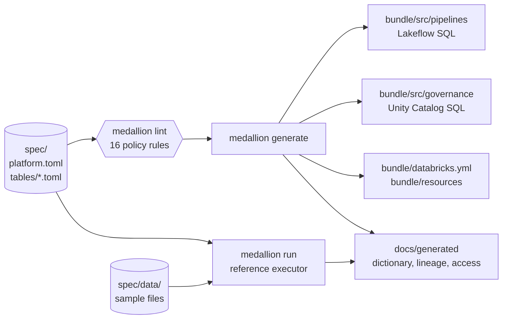

# Architecture

The specification in [`spec/`](../spec) is the source of truth. Everything else is generated from it
or checks it.

## Layers

| Layer | Holds | Built as | Rule of thumb |
|---|---|---|---|
| Landing | Files as delivered, one folder per source | Volume | Never edited |
| Bronze | Every column as text, plus file, ingestion time and rescued fields | Streaming table, append-only | Nothing here can fail on bad data |
| Silver | Typed, validated, current state; type 1 or type 2 | Staging table, change flow, target, quarantine | The trusted layer |
| Gold | Aggregates at a declared grain | Materialized view | What consumers read |

Each silver table is four objects: `<name>_validated` (typed rows with expectations attached),
`<name>` (the target of an `AUTO CDC` flow), the flow itself, and `<name>_quarantine` (rows that
failed a `drop` expectation, with the rules they failed). See
[lineage](generated/lineage.md).

## How a row travels

1. A file lands in `/Volumes/<catalog>/landing/raw/<source>/`.
2. Bronze reads it with `read_files`, keeps every value as text, and rescues fields that do not fit.
3. Silver converts each column with `try_cast`, so a bad value becomes NULL instead of an error.
4. Expectations then decide: `warn` counts it, `drop` sends the row to quarantine, `fail` stops the update.
5. Rows that pass go through the change flow, which orders events by the sequence column, applies deletes, and keeps either the latest row (type 1) or every version (type 2).
6. Gold selects from silver, reading only the open version of any type 2 table.

## Governance

- **Classification and ownership** are in each table spec and stamped on the table as properties.
- **Personal data** columns carry a column mask. Members of the privileged group and the pipeline's
  runner group see real values; everyone else sees the mask. The runner is exempt so the pipeline
  reads real values and does not write masked values downstream
  ([ADR 0005](adr/0005-masks-in-ddl-with-a-runner-exemption.md)).
- **Access** is granted to groups by role, per environment. Consumers read gold only; nobody reads
  bronze in production ([access matrix](generated/access.md)).
- **Quality** is declared per table and visible in the [register](generated/quality.md).

## Environments

One bundle, three targets (`dev`, `staging`, `prod`), each with its own catalog. `dev` runs in
development mode; the others run in production mode as a service principal. A job runs the
governance SQL first, then refreshes the pipeline ([ADR 0007](adr/0007-one-bundle-three-targets.md)).
