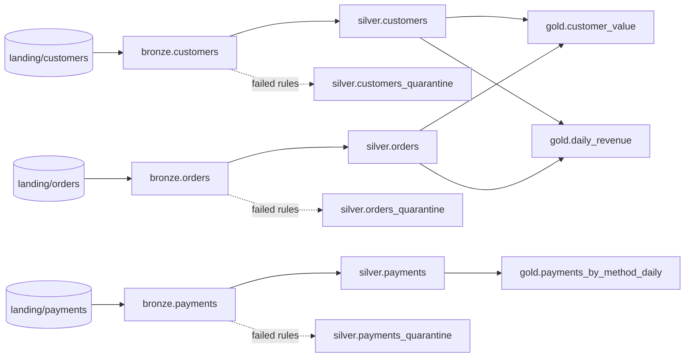

<!-- Generated by medallion from spec/. Do not edit by hand. -->

# Lineage

Solid arrows carry data into the next table; dotted arrows send rows that fail a drop expectation to quarantine. Each silver table also has a `_validated` staging table, left out here.

